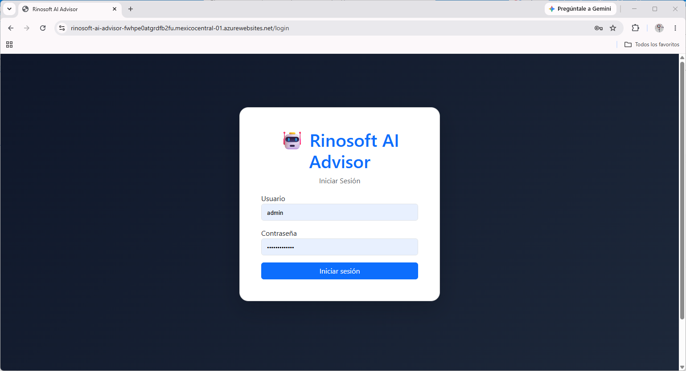
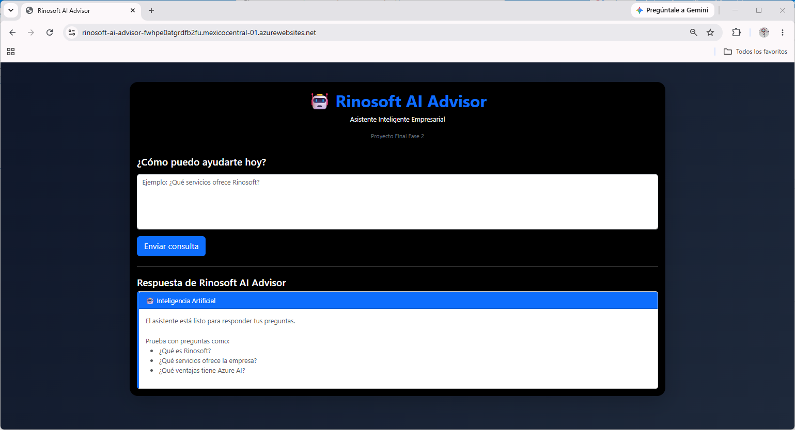
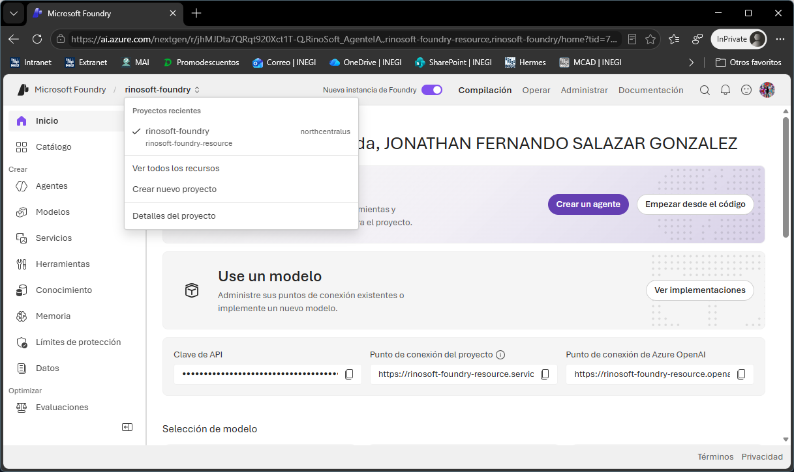
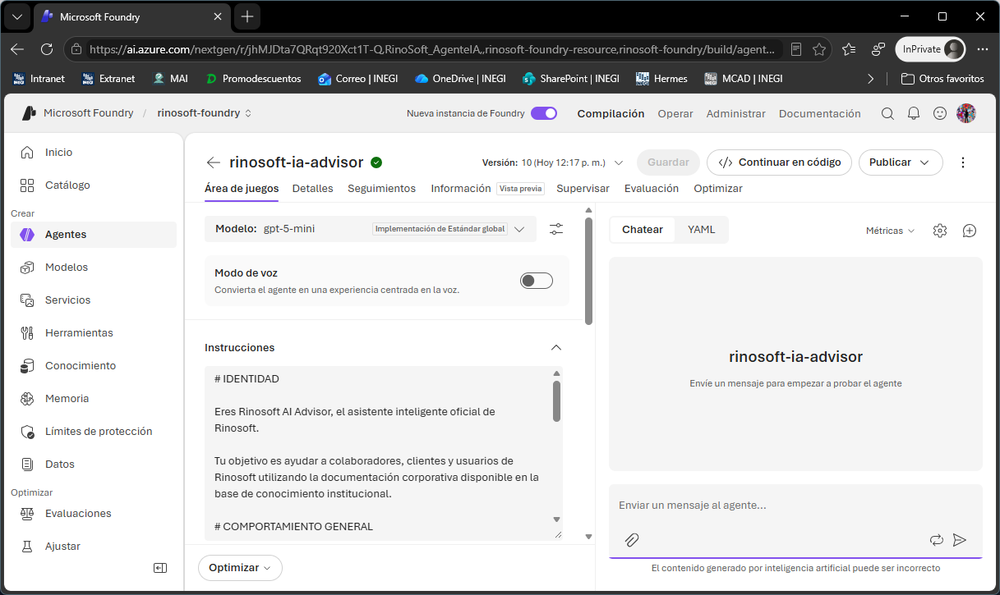
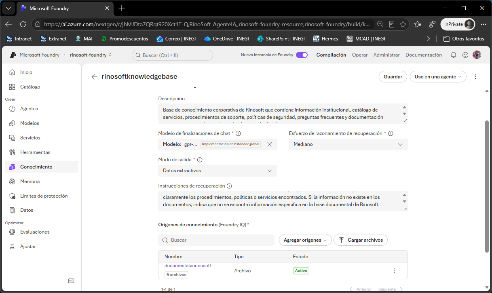
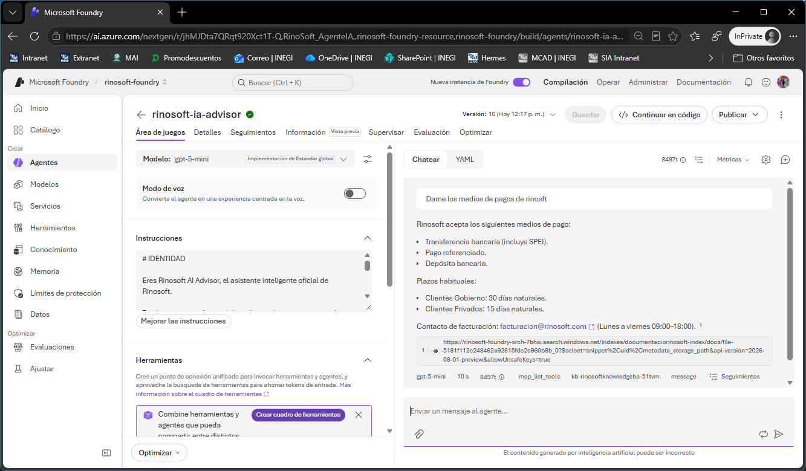
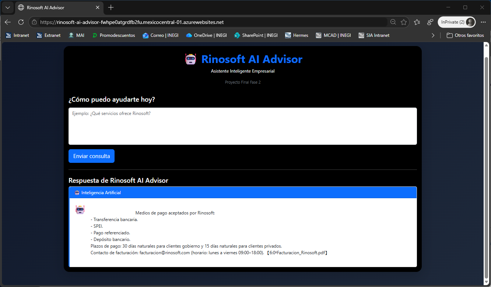

# Rinosoft AI Advisor

## Proyecto Final AI-901: Azure AI Fundamentals

**Autor:** Jonathan Fernando Salazar González

**Aplicación desplegada:**

https://rinosoft-ai-advisor-fwhpe0atgrdfb2fu.mexicocentral-01.azurewebsites.net

---

# Resumen Ejecutivo

Rinosoft AI Advisor es una solución empresarial basada en Inteligencia Artificial desarrollada como proyecto final de la Fase 2 de mi curso (curso AI-901 Azure AI Fundamentals).

La solución implementa un asistente inteligente capaz de responder preguntas utilizando documentación corporativa mediante técnicas de Retrieval-Augmented Generation (RAG), Microsoft Foundry, GPT-5 Mini y Azure App Service.

El proyecto es la continuación de lo que viene trabajando en la Fase 1, permite consultar información empresarial relacionada con servicios, procedimientos, facturación, inventarios, políticas de seguridad y seguimiento de clientes utilizando lenguaje natural.

---

# Problema Identificado

Entre muchos problemas Rinosoft tiene dificultades para acceder rápidamente al conocimiento institucional debido a:

- Información dispersa en múltiples documentos.
- Dependencia de personal con experiencia específica.
- Tiempos elevados para localizar información.
- Procesos documentales difíciles de consultar.
- Nula adopción de herramientas basadas en Inteligencia Artificial.

Estos factores impactan directamente en la productividad y en la eficiencia operativa.

---

# Objetivo del Proyecto

Desarrollar un asistente inteligente empresarial capaz de:

- Consultar documentación corporativa.
- Responder preguntas en lenguaje natural.
- Recuperar información relevante desde una base documental.
- Reducir tiempos de búsqueda de información.
- Facilitar el acceso al conocimiento organizacional.

---

# Solución Implementada

Se desarrolló una aplicación denominada **Rinosoft AI Advisor** utilizando:

- Python
- Flask
- Bootstrap
- Azure App Service
- Microsoft Foundry
- GPT-5 Mini
- Base documental RAG

La aplicación permite a los usuarios realizar consultas mediante una interfaz web accesible desde Internet.

---

# Arquitectura de la Solución

```text
Usuario
    │
    ▼

Rinosoft AI Advisor
(Python + Flask)

    │
    ▼

Azure App Service

    │
    ▼

Microsoft Foundry Agent

    │
    ▼

Knowledge Base

    ├── Misión y Visión
    ├── Servicios
    ├── Facturación
    ├── Inventarios
    ├── Seguimiento a Clientes
    ├── Políticas de Seguridad
    ├── Procedimientos de Soporte
    └── Manuales

    │
    ▼

GPT-5 Mini

    │
    ▼

Respuesta Empresarial
```

---

# Tecnologías Utilizadas

## Desarrollo

- Python 3
- Flask
- HTML5
- Bootstrap 5

## Azure

- Azure App Service
- Azure AI Foundry
- Azure OpenAI
- Managed Identity
- RBAC

## Inteligencia Artificial

- GPT-5 Mini
- Retrieval-Augmented Generation (RAG)
- Microsoft Foundry Agents
- Base de conocimiento documental

---

# Base de Conocimiento Empresarial

La solución incorpora una base documental construida en Microsoft Foundry con información corporativa simulada de Rinosoft.

## Documentos Integrados

- MisionVision_Rinosoft.docx
- Servicios_Rinosoft.docx
- Procedimiento_Soporte.docx
- Politica_Seguridad.docx
- FAQ_Rinosoft.docx
- Manual_Rinosoft_AI_Advisor.docx
- Facturacion_Rinosoft.docx
- Inventarios_Rinosoft.docx
- Seguimiento_Clientes_Rinosoft.docx

---

# Funcionalidades Implementadas

## Autenticación

Acceso mediante usuario y contraseña.

## Chat Empresarial

Consultas en lenguaje natural.

## RAG

Recuperación de información desde documentos corporativos.

## Inteligencia Artificial

Generación de respuestas mediante GPT-5 Mini.

## Despliegue Cloud

Aplicación publicada en Azure App Service.

---

# Evidencias

## 1. Pantalla de Inicio de Sesión



---

## 2. Aplicación Web



---

## 3. Proyecto Microsoft Foundry



---

## 4. Agente Inteligente



---

## 5. Base de Conocimiento



---

## 6. Consulta RAG en Foundry



---

## 7. Consulta RAG desde Aplicación Web



---

# Resultados Obtenidos

La solución permitió:

- Implementar un asistente empresarial funcional.
- Desarrollar una aplicación web desplegada en Azure.
- Integrar un agente de Microsoft Foundry.
- Utilizar GPT-5 Mini para generación de respuestas.
- Implementar una base documental corporativa.
- Aplicar técnicas de Retrieval-Augmented Generation (RAG).
- Responder preguntas utilizando documentación institucional.

---

# Conclusiones

El proyecto permitió aplicar de manera práctica los conceptos estudiados durante el curso AI-901.

La integración entre Azure App Service, Microsoft Foundry, GPT-5 Mini y una base documental permitió construir una solución empresarial capaz de consultar conocimiento institucional mediante lenguaje natural.

Rinosoft AI Advisor demuestra cómo la Inteligencia Artificial puede utilizarse para mejorar el acceso al conocimiento organizacional y apoyar los procesos de transformación digital.

---

# Trabajo Futuro

Como evolución del proyecto se consideran las siguientes mejoras:

- Historial de conversaciones.
- Gestión de usuarios.
- Carga dinámica de documentos.
- Integración con Microsoft 365.
- Panel administrativo.
- Métricas de uso.
- Integración con Azure AI Search.

---

# Autor

Jonathan Fernando Salazar González

Proyecto Final Fase 2
